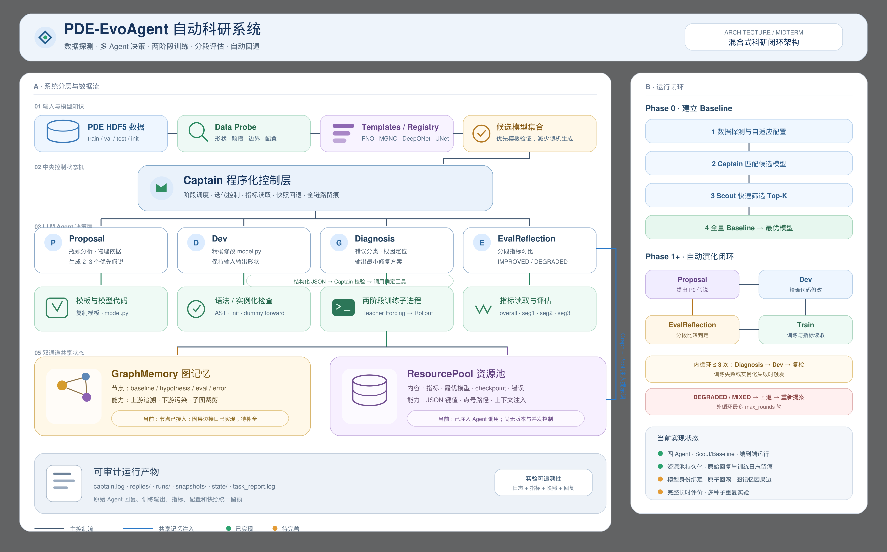

# 面向 PDE 神经算子的智能体

## 创新训练项目中期检查报告

| 项目信息 | 内容 |
|---|---|
| 项目名称 | 面向 PDE 神经算子的智能体 |
| 项目负责人 | 林泽智 |
| 项目成员 | 韦元豪、陈永喆 |
| 指导教师 | 贾继伟 |
| 所在学院 | 吉林大学数学学院 |
| 项目周期 | 2026 年 5 月至 2027 年 5 月 |
| 中期检查时间 | 2026 年 10 月 |

---

## 摘要

本项目面向神经算子建模过程中模型选择、训练评估和结构调整高度依赖人工经验的问题，构建了一个由大语言模型驱动的 PDE 科研多 Agent 系统。系统以 Captain 为控制核心，组织 Proposal、Dev、Diagnosis 和 EvalReflection 等节点，完成数据探测、候选模型筛选、Baseline 训练、改进假说生成、代码修改、结果评估和自动回退。

中期阶段已完成文献调研、PDEBench/HDF5 数据适配、FNO 基线复现和分段评价体系建设，并以一维 diffusion 数据为例打通了完整自动工作流。系统能够从数据探测连续执行到多轮演化和最终评估，运行时间约 4 小时 48 分钟。

运行结果也表明，LLM 参与长流程科研时存在行为不稳定、上下文状态衰减和结论事后合理化等风险。项目据此提出结构化动作校验、模型身份绑定、原子快照、确定性评价和独立运行记录等边界约束，下一阶段将在保证实验可信的基础上扩展到不同 PDE 数据集。

**关键词：** 神经算子；偏微分方程；多 Agent；大语言模型；实验自动化

---

## 一、项目是否按立项计划进行

### 1.1 原定实施计划

根据项目申请书，项目分为四个阶段：

1. 调研与基线搭建：完成神经算子文献调研、PDEBench 数据格式和评测规则学习、FNO 基线复现及评价标准确定；
2. Agent 系统开发：完成多 Agent 架构、各功能节点、状态传递、迭代控制和容错回退，并确保系统端到端运行；
3. 模型优化实验：开展多轮自主优化，并逐步扩展到不同 PDE 数据；
4. 总结与成果整理：完成最终评估、研究报告、论文和结题材料。

### 1.2 当前完成情况

截至 2026 年 10 月，项目总体按照立项计划推进。第一阶段任务已经完成，第二阶段的主体架构和完整工作流已经形成。

| 原计划任务 | 当前完成情况 |
|---|---|
| 神经算子文献调研 | 已完成。立项阶段围绕 DeepONet、FNO、PI-DeepONet、PINN、ICON、PDEBench 和大语言模型智能体等方向完成研究现状分析，形成 10 篇主要参考文献，并整理项目论文资料库 |
| PDEBench/HDF5 格式与评测规则 | 已完成。系统能够自动读取 HDF5 数据，识别数据维度、频谱和边界特征，并生成空间降采样、输入时间窗口和数据字段配置 |
| FNO 基线复现 | 已完成。系统通过 Scout 比较 FNO、MGNO、DeepONet 和 UNet，完成全量 Baseline 训练，并将 FNO 选为最优基线模型 |
| 优化目标和评价标准 | 已完成。已建立 overall、seg1、seg2、seg3 分段 Rel-MSE 评价框架，并结合训练与推理耗时形成模型演化判定依据。当前一维 diffusion 数据只有 seg1、seg2 两个有效评价区间，seg3 在更长预测序列中启用 |
| 多 Agent 整体架构 | 已完成原型设计。系统形成 Captain、Proposal、Dev、Diagnosis 和 EvalReflection 等节点，覆盖方案提出、代码修改、错误诊断、实验执行和结果评估 |
| 各 Agent 功能开发 | 已完成。各节点具备结构化输入输出，并通过统一 LLM 客户端调用大模型；实验执行由确定性训练工具完成 |
| 状态传递与迭代控制 | 已完成。系统使用 GraphMemory 记录执行节点，使用 ResourcePool 保存数据特征、指标、最优模型和文件路径，并支持 Scout、Baseline 及多轮迭代 |
| 容错回退机制 | 已实现基础流程。训练失败、指标无法读取或评估退化时能够触发修复、快照保存和回退；模型代码与 checkpoint 的一致性仍需进一步完善 |
| 稳定端到端运行 | 已完成阶段性验证。以 1D diffusion 数据为例，系统能够完整运行从数据探测到演化评估的全流程；系统稳定性和实验结论可靠性将在下一阶段继续验证 |

### 1.3 技术路线调整

申请书原计划使用 LangGraph 编排多 Agent。结合实际开发需求，当前原型采用基于 Python 的显式状态机作为 Captain 控制层，负责阶段调度、模型筛选、训练执行、结果评估和回退；各子 Agent 通过结构化输入输出参与科研闭环。

该调整保留了申请书提出的多节点协作、状态传递和迭代控制目标，同时降低了训练流程调试和运行追踪的复杂度。

### 1.4 进度判断

项目总体按照立项计划推进。第一阶段文献调研、数据适配、Baseline 复现和评价体系建设已经完成；第二阶段多 Agent 架构、核心节点和完整工作流已经实现。当前工作重点已由功能开发转向模型身份校验、回退一致性和重复实验验证，不影响第三阶段模型优化实验的开展。

---

## 二、项目取得的阶段性成果

### 2.1 完成多 Agent 科研闭环原型

系统由 Captain 负责全局调度，Proposal、Dev、Diagnosis 和 EvalReflection 分别承担方案提出、代码修改、错误诊断和结果评估。数据探测、模型筛选、训练执行、指标评价和版本回退均通过结构化流程连接。

系统总体架构、科研闭环与共享状态关系见图 1。



*图 1  PDE-EvoAgent 系统总体架构、科研闭环与共享状态设计*

系统采用“程序化控制层 + LLM Agent 决策层 + 确定性工具层”的混合架构。Captain 控制实际执行顺序，LLM 负责需要专业推理的环节，训练、指标计算和文件操作由确定性程序完成。

### 2.2 实现数据与模型自动适配

系统开发了 HDF5 数据探测工具，能够自动分析：

- 数据维度和空间分辨率；
- 频谱特征，判断平滑场或高频主导场；
- 边界条件类型；
- 时间演化趋势；
- 数据异常值和 NaN/Inf 状态。

在模型方面，项目建立了 FNO、MGNO、DeepONet 和 UNet 四类模板，并通过 Registry 描述模型适用场景、构造参数和输入输出规范。Phase 0 可以自动完成候选模型生成、语法检查、实例化检查和小样本 Scout 训练。

### 2.3 完成 Baseline 训练与分段评价

训练器实现了两个阶段：

1. **Teacher Forcing**：利用真实历史窗口进行单步监督训练；
2. **Progressive Rollout**：逐步增加自回归预测长度，使模型适应自身预测误差。

系统能够保存最优 checkpoint，并计算 overall、seg1、seg2、seg3 分段 Rel-MSE。以 1D diffusion 数据为例，Scout 阶段结果如下：

| 模型 | Overall Rel-MSE | Seg1 | Seg2 |
|---|---:|---:|---:|
| FNO | 0.0279 | 0.0315 | 0.0240 |
| MGNO | 0.0305 | 0.0312 | 0.0297 |
| DeepONet | 0.1782 | 0.2521 | 0.0993 |
| UNet | 1.6923 | 1.5673 | 1.8257 |

系统保留 FNO 和 MGNO 进行全量训练，最终将 FNO 确定为 Baseline。日志记录的 FNO 验证结果为：

```text
Overall Rel-MSE: 8e-06
Seg1:           9e-06
Seg2:           8e-06
```

当前数据只有两个有效评价区间，因此该结果不包含 seg3 性能判断。

### 2.4 已打通完整自动工作流

以 1D diffusion 数据集为例，系统完成了一次约 4 小时 48 分钟的完整工作流运行：

```text
数据探测
→ 四模型 Scout
→ FNO/MGNO 全量 Baseline
→ Round 1 演化与退化判定
→ 回退流程
→ Round 2 演化与评估
→ 结果记录
```

| 阶段 | 日志结果 |
|---|---|
| 数据探测 | 识别训练数据、验证数据、平滑场特征及数据配置 |
| Scout | 完成四个候选模型比较，约 17 分钟 |
| FNO Baseline | 训练约 87 分钟，被选为最优 Baseline |
| MGNO Baseline | 训练约 58 分钟 |
| Round 1 | 约 21 分钟，判定 DEGRADED 并触发回退流程 |
| Round 2 | 约 100 分钟，完成训练并生成评估结果 |

该运行证明系统能够无中断地完成从数据读取到模型演化和结果评估的完整流程。由于模型身份和 checkpoint 一致性尚存在问题，Round 1、Round 2 的结果暂不作为最终性能结论，而作为流程验证和问题定位依据。

### 2.5 建立共享状态与实验追溯机制

系统实现了两类共享状态：

- **GraphMemory**：记录 Baseline、假说、评估、错误和里程碑等执行节点；
- **ResourcePool**：保存数据探测结果、Scout 指标、Baseline 指标、最优模型、checkpoint 路径和错误信息。

每次调用 Agent 时，系统会将图记忆和资源池注入上下文，使不同节点能够共享实验状态。Agent 原始回复、训练输出、指标、快照和运行日志均被持久化，为后续实验审计提供依据。

### 2.6 形成代码、论文和文档成果

当前项目已经形成以下工程结构：

| 目录 | 内容 |
|---|---|
| `agent/` | Captain、LLM 客户端、当前模型和训练器 |
| `prompts/` | Captain、Proposal、Dev、Diagnosis、EvalReflection 提示词 |
| `templates/` | 四类神经算子模板和 Registry |
| `shared_memory/` | GraphMemory 与 ResourcePool |
| `tools/` | 数据探测和测试集评估工具 |
| `output/` | 运行日志、Agent 回复、指标和快照 |
| `docs/` | 论文、工作日志、技术报告和中期材料 |

项目论文资料库收录 11 篇 PDF，覆盖 DeepONet、FNO、PI-DeepONet、PINN、ICON、PDEBench、FourCastNet、FuXi、Geo-FNO、DeepXDE 和 PDE-Agent。

### 2.7 阶段性成果总结

1. 完成多 Agent 自动优化系统的总体设计和核心代码；
2. 实现 HDF5 数据探测、模型匹配和自适应训练配置；
3. 完成四类神经算子模板、Scout 和全量 Baseline 流程；
4. 实现 Teacher Forcing 与 Progressive Rollout 两阶段训练；
5. 建立分段评价和 Agent 结果判定机制；
6. 以 1D diffusion 数据为例打通完整自动工作流；
7. 建立图记忆、资源池、实验日志和快照等追溯机制；
8. 形成论文资料库、系统架构说明和中期报告材料。

总体而言，本阶段已经形成可完整运行的多 Agent 科研系统原型，完成了项目从方案设计到工作流验证的阶段性目标。

---

## 三、项目运行中存在的主要问题及解决问题的方式方法

LLM 能够生成研究方案、修改代码和解释结果，但在多步骤科研流程中仍存在行为不稳定、长上下文状态衰减和结论事后合理化等风险。当前问题可以归纳为三类。

### 3.1 Agent 动作不稳定，需要可验证的执行约束

**问题表现：**

Round 1 的 Dev 返回空编辑 `edits: []`，系统仍继续启动训练。该轮实际上没有实施 Proposal 提出的修改，但仍被作为一次改进实验进行评价。

**解决方式：**

将 Agent 输出从自然语言建议转换为可验证的结构化动作：

1. Dev 输出必须通过 JSON Schema 校验；
2. `edits` 不得为空，`old` 与 `new` 必须不同且唯一匹配；
3. 修改前后必须产生文件哈希变化；
4. 修改后的代码必须通过语法、实例化和 dummy forward 检查；
5. 任一检查失败均不得启动训练；
6. 重试达到上限后，本轮标记为无效，由 Proposal 重新提出方案。

### 3.2 长流程状态衰减，需要模型身份与版本约束

**问题表现：**

Baseline 选择 FNO 后，Round 1 和 Round 2 实际实例化的是 MGNO。Round 2 被判定为 IMPROVED 时，系统只更新了指标，没有同步更新模型身份和 checkpoint。多次运行还被追加到同一日志中，导致不同实验的状态相互污染。

**解决方式：**

1. 每次运行生成唯一 `run_id`，独立保存配置、日志、回复、指标和快照；
2. Proposal、Dev、模型文件和 checkpoint 统一传递 `model_id`；
3. 训练前校验 Proposal 模型、实际模型类和 checkpoint 模型身份一致；
4. 禁止训练器在多个模型类之间自动猜测；
5. 将模型代码、checkpoint、数据配置、指标和 manifest 保存为原子快照；
6. 回退后重新检查语法、实例化、forward 和 checkpoint 加载；
7. IMPROVED 时同步更新最优模型、指标、checkpoint 和快照。

### 3.3 评估可能事后合理化，需要确定性事实链

**问题表现：**

日志中存在评估结论与实际修改不一致的情况：

- Round 1 没有实际修改代码，却被解释为“多步 rollout 损失导致退化”；
- Round 2 的 Dev 明确保持 `width=32`，评估却声称“扩大 width 有效”；
- 实际训练对象为 MGNO，评估仍将其解释为 FNO 能力提升。

**解决方式：**

1. 指标计算和 IMPROVED、DEGRADED、MIXED 判定由确定性代码完成；
2. LLM 只解释结果和提出方向，不定义实验事实；
3. 评估输入包含实际 diff、模型身份、训练配置和指标来源；
4. 建立不可修改的实验事实账本；
5. 参数没有变化时禁止声称该参数带来提升；
6. 模型身份不一致时直接判定本轮无效；
7. 关键实验重复多个随机种子，并保留全部失败结果。

### 3.4 核心问题总结

| LLM 局限 | 运行中的表现 | 系统边界约束 |
|---|---|---|
| 行为不稳定 | 空编辑仍继续训练 | 结构化动作契约、diff 哈希、语法与实例化检查 |
| 长流程状态衰减 | FNO 实验中实际加载 MGNO，版本与日志混用 | `run_id`、`model_id`、原子快照、回退复检 |
| 事后合理化 | 修改内容与评估结论不一致 | 确定性评价、事实账本、证据引用、多种子验证 |

总体原则是：Agent 负责提出方案和解释结果，确定性系统负责执行、验证和记录事实。Agent 可以失败，但无效输出、模型错配和未经证据支持的结论不能进入下一轮实验。

---

## 四、下阶段工作计划及核心问题工作方案

### 4.1 总体思路

下阶段按照“先完成可靠性约束，再扩展到不同 PDE 数据集”的顺序推进。暂不盲目扩大模型搜索空间，先保证每次实验都可以说明修改内容、训练模型、checkpoint 和结果来源，再开展跨数据集优化实验。

### 4.2 核心问题工作方案

#### 4.2.1 Agent 动作校验

建立事务式代码修改流程：

```text
Proposal 指定目标
→ Dev 输出结构化修改
→ JSON 与非空校验
→ 文件白名单检查
→ old/new 唯一匹配
→ 临时副本应用修改
→ 文件哈希变化检查
→ 语法、实例化和 forward 检查
→ 原子替换正式文件
→ 允许训练
```

无效动作不启动训练，最多重试 2–3 次；仍失败时终止本轮并重新提案。

#### 4.2.2 模型身份与原子版本

在 Proposal、Dev、模型文件和 checkpoint 中统一 `model_id`，训练前执行三方一致性校验。每个快照保存：

```text
snapshot/
├── model.py
├── checkpoint.pt
├── data_config.json
├── metrics.json
└── manifest.json
```

`manifest.json` 记录模型名称、模型类、代码哈希、checkpoint 哈希、指标、运行编号和创建时间。回退时整体恢复，并重新执行模型加载检查。

#### 4.2.3 确定性评价与可重复实验

1. overall、seg1、seg2 及适用的 seg3 由代码计算；
2. IMPROVED、DEGRADED、MIXED 先由确定性规则判定；
3. EvalReflection 仅解释原因和提出方向；
4. 建立不可修改的实验事实账本；
5. 每次运行使用独立目录，避免日志和回复跨运行混合；
6. 关键实验固定随机种子并重复多次。

### 4.3 后续工作安排

后续工作按照“先完成可靠性约束，再扩展到不同 PDE 数据集”的顺序推进。

| 阶段 | 主要工作 | 预期成果 |
|---|---|---|
| 可靠性约束阶段 | 完善 Agent 动作校验、模型身份绑定、独立运行目录、原子快照、回退复检和确定性评价 | 可验证、可追溯、可重复的实验执行流程 |
| 数据集扩展阶段 | 在不同 PDE 数据集上重跑 Baseline，开展模型结构和训练策略的受控演化，并探索多物理参数及二维 PDE | 多种子基线、跨数据集对比、二维 PDE 可行性结果 |
| 总结阶段 | 汇总消融实验、可靠性测试和不同数据集的实验结果 | 实验数据、图表、论文和结题材料 |

### 4.4 下阶段重点实验

1. **Baseline 复核**：在不同 PDE 数据集上固定数据划分和随机种子，重新确认基线指标；
2. **模型结构优化**：研究 modes、width、网络深度、残差连接和物理约束在不同数据分布下的影响；
3. **训练策略优化**：比较单步训练、渐进 rollout、时间加权损失和物理正则化；
4. **多物理参数泛化**：研究模型对粘性系数等物理参数变化的适应能力；
5. **二维 PDE 拓展**：验证系统能否迁移到 Darcy Flow 等二维数据；
6. **消融实验**：分析 GraphMemory、ResourcePool、Scout 和 Planner–Actor 循环的实际贡献。

### 4.5 预期成果与验收标准

下阶段预期形成：

1. 具备动作校验、模型身份绑定和原子回退的多 Agent 系统；
2. 多个 PDE 数据集上的可重复 Baseline 和演化实验；
3. 一组模型结构、训练策略和系统组件消融结果；
4. 系统可靠性测试和失败案例分析；
5. 面向论文、软件著作权和结题报告的材料。

验收标准包括：

- 空编辑和越权修改拦截率达到 100%；
- 模型身份错配能够被训练前检查发现；
- 回退后的模型代码、模型身份和 checkpoint 完全一致；
- 评估结论能够由日志、diff 和指标文件复现；
- 关键实验在多个随机种子下具有一致的变化方向。

---

## 五、经费使用情况

根据项目申请书，项目批准预算总额为 **11,500 元**。截至中期检查，项目累计支出 **1,400 元**。

| 序号 | 经费科目 | 预算金额（元） | 已支出（元） | 使用说明 |
|---:|---|---:|---:|---|
| 1 | 论文发表费用 | 5,000 | 0 | 尚未发生论文发表支出 |
| 2 | 图书资料与打印 | 1,500 | 200 | 用于查阅资料、材料打印等 |
| 3 | LLM 模型 API | 3,000 | 1,200 | 用于购买 DeepSeek API，支持多 Agent 推理、代码生成、错误诊断和结果评估 |
| 4 | 其他预留费用 | 2,000 | 0 | 按项目进度暂未使用 |
|  | **合计** | **11,500** | **1,400** |  |

其中，图书资料费用和纸质打印费用合并列示，预算合计为 1,500 元。

项目经费按照申请书批准的预算科目使用。购买 DeepSeek API 支出 1,200 元，用于支持多 Agent 的模型匹配、方案生成、代码修改、错误诊断和实验结果分析；查阅资料及打印支出 200 元。其余预算将根据后续实验和成果整理进度安排使用，所有支出均按照学校经费管理规定执行并保留相关凭证。

经费用途与项目研究任务一致，符合申请书预算安排。

---

## 附录：主要材料

- 项目论文资料库：`../papers/README.md`
- 完整运行日志：`../../output/captain.log`
- 当前系统代码：`../../agent/`
- 数据探测与评估工具：`../../tools/`

